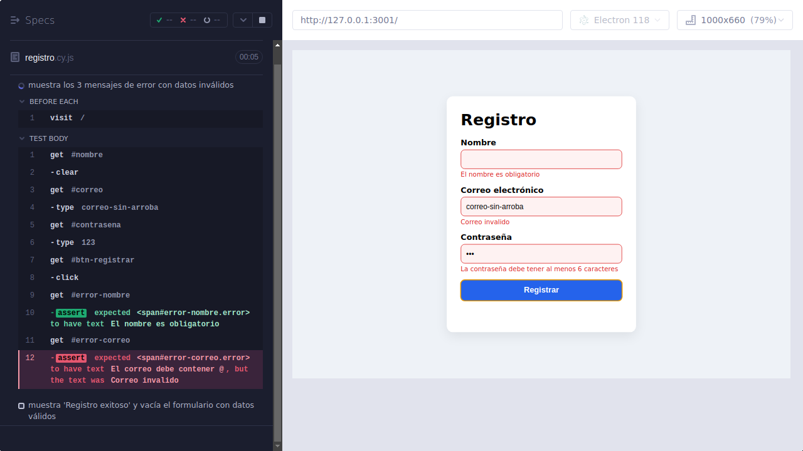

# Evidencia — Serie III

**Estudiante:** Brando Arnoldo Lemus Felipe · **Carné:** 0908-18-24318

Repositorio: https://github.com/Blemus23/0908-18-24318

## 1. Repositorio y commits
Proyecto subido con git en varios commits pequeños y descriptivos:

```
*   86eced3 Merge pull request #5 from Blemus23/evidencia
|\  
| * 125c46f Documenta la evidencia de Cypress, el workflow y la proteccion de main
|/  
*   7021f32 Merge pull request #4 from Blemus23/demo-falla
|\  
| * 5b9725a Restaura el mensaje de error del correo (corrige la prueba)
| * e2242e3 Cambia el mensaje de error del correo (rompe una prueba a proposito)
|/  
*   eadee70 Merge pull request #3 from Blemus23/corrige-ci
|\  
| * 0f59c77 Workflow: npm ci, levanta la pagina y corre Cypress sin la accion (compatible con Node 24)
| * 8cc2538 Usa 127.0.0.1 para esperar el servidor y en baseUrl (corrige el CI)
| * bb60357 Corrige el carne y agrega el nombre del estudiante en el README
| * 4b2fda0 Corrige el arranque del servidor en CI (escucha en IPv4 e IPv6)
|/  
* 4bb84f2 Documenta el proyecto, las pruebas y la integracion continua
* 24b7214 Agrega workflow de GitHub Actions que corre Cypress en cada push
* d2a601d Configura Cypress (video y capturas automaticas) y agrega pruebas del registro
* 59f6aa0 Agrega validacion del formulario en JavaScript sin recargar la pagina
* 3428bcb Agrega estructura del formulario de registro (HTML y CSS)
```

## 2. Workflow de GitHub Actions
> Nota: las primeras corridas fallaron antes de llegar a Cypress: la acción `cypress-io/github-action@v6` no logra esperar al servidor cuando GitHub la fuerza a correr con Node 24. Se corrigió mediante un Pull Request reemplazándola por pasos simples (`npm ci`, levantar la página, esperar con `curl` y `npx cypress run`).

- Archivo: [`.github/workflows/cypress.yml`](../.github/workflows/cypress.yml)
- Se ejecuta en cada `push` (y en cada Pull Request a `main`): instala dependencias, levanta la página y corre Cypress.
- Corrida inicial en `main`: https://github.com/Blemus23/0908-18-24318/actions/runs/44930259016 — **passed (verde)**
- Corrida final en `main` (después del merge): https://github.com/Blemus23/0908-18-24318/actions/runs/44930538485 — **passed (verde)**

## 3. Video y capturas generados por Cypress
`cypress.config.js` tiene `video: true` (graba toda la corrida) y `screenshotOnRunFailure: true` (Cypress captura por sí mismo las pruebas que fallan). El workflow los sube siempre como artifact **`cypress-evidencia`** (Actions → la corrida → *Artifacts*).

| Evidencia | Origen | Archivo |
|---|---|---|
| Video de la corrida en verde | https://github.com/Blemus23/0908-18-24318/actions/runs/44930259016 | [video-corrida-verde.mp4](evidencia/video-corrida-verde.mp4) |
| Video de la corrida en rojo | https://github.com/Blemus23/0908-18-24318/actions/runs/44930340477 | [video-corrida-roja.mp4](evidencia/video-corrida-roja.mp4) |
| Captura automática de la prueba que falló | https://github.com/Blemus23/0908-18-24318/actions/runs/44930340477 | [captura-prueba-fallida.png](evidencia/captura-prueba-fallida.png) |

Nombre original de la captura: `Formulario de registro -- muestra los 3 mensajes de error con datos inválidos (failed).png`



## 4. Protección de la rama `main`
Configuración aplicada (Settings → Branches):

```json
{"aplica_a_admins":true,"borrar_rama":false,"checks_obligatorios":["cypress"],"force_push":false,"rama_actualizada":true,"requiere_pull_request":true}
```

- **Status check obligatorio:** el check `cypress` debe pasar antes de cualquier merge.
- **Push directo bloqueado:** `main` solo acepta cambios por Pull Request (también para el administrador).

Intento de push directo a `main` (bloqueado = **sí**):

```
git : remote: error: GH006: Protected branch update failed for refs/heads/main.        
En C:\Users\casta\Desktop\registro-cypress\evidencia-fix.ps1: 53 Carácter: 13
+ $pushOut = (git push origin main 2>&1 | Out-String).Trim()
+             ~~~~~~~~~~~~~~~~~~~~~~~~~
    + CategoryInfo          : NotSpecified: (remote: error: ...s/main.        :String) [], RemoteException
    + FullyQualifiedErrorId : NativeCommandError
 
remote: 
remote: - Changes must be made through a pull request.        
remote: 
remote: - Required status check "cypress" is expected.        
To https://github.com/Blemus23/0908-18-24318.git
 ! [remote rejected] main -> main (protected branch hook declined)
error: failed to push some refs to 'https://github.com/Blemus23/0908-18-24318.git'
```

## 5. Demostración con Pull Request
PR: https://github.com/Blemus23/0908-18-24318/pull/4

1. Se cambió el mensaje de error del correo → la prueba falló → CI en **rojo** (failed (rojo)).
2. Intento de merge con el CI en rojo (bloqueado = **sí**):
```
gh pr merge 4 -> rechazado: el check obligatorio 'cypress' fallo.

Corridas de la rama demo-falla:
completed	success	Demo: cambio que rompe una prueba	Pruebas Cypress	demo-falla	pull_request	44930455975	43s	2026-11-21T17:30:54Z
completed	success	Restaura el mensaje de error del correo (corrige la prueba)	Pruebas Cypress	demo-falla	push	44930448736	43s	2026-11-21T17:30:50Z
completed	failure	Demo: cambio que rompe una prueba	Pruebas Cypress	demo-falla	pull_request	44930340477	48s	2026-11-21T17:29:45Z
completed	failure	Cambia el mensaje de error del correo (rompe una prueba a proposito)	Pruebas Cypress	demo-falla	push	44930334711	38s	2026-11-21T17:29:41Z
```
3. Se corrigió el mensaje → CI en **verde** (passed (verde)) → merge permitido.